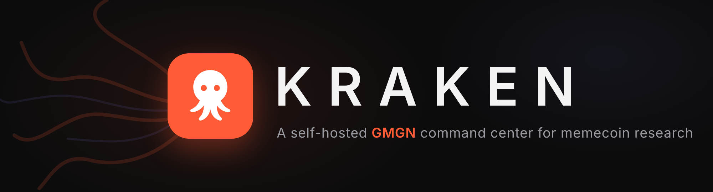
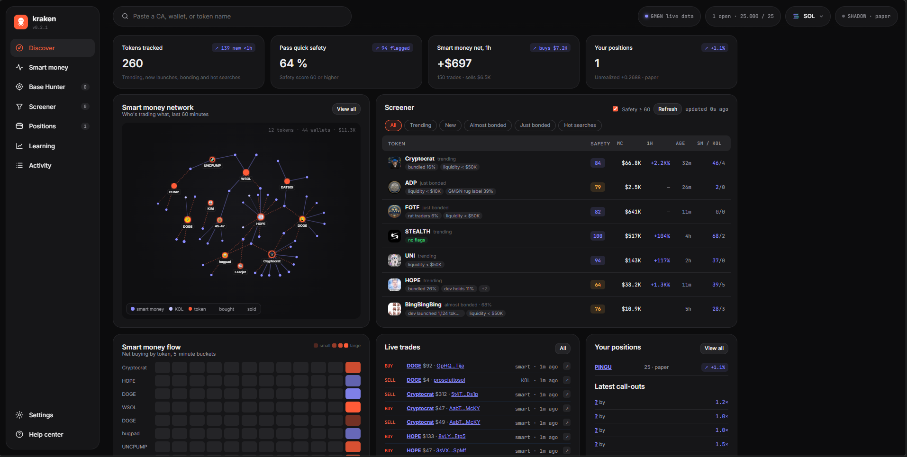
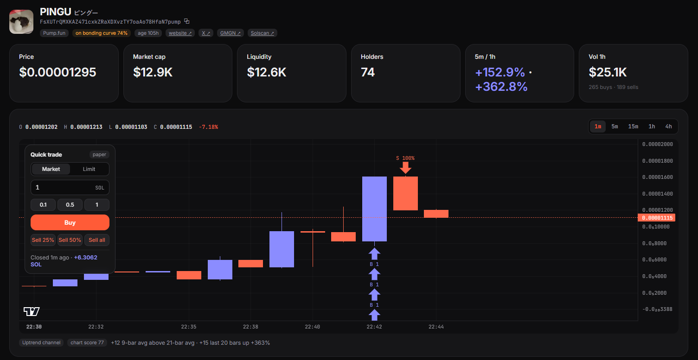

<div align="center">



**A self-hosted GMGN command center: discover tokens, research any CA or wallet, follow smart money, and trade with guard rails. Built on [gmgn-cli](https://www.npmjs.com/package/gmgn-cli).**

Paste a contract address and get a 0–100 safety score with every deduction explained, who holds it, who launched it and what they launched before. Paste a wallet and see who funded it and who it moves money with on a connection graph. Works on **Solana, BSC, Base and Ethereum**.

Runs on your own computer · uses your own GMGN API key · keys never leave your machine · paper trading by default

[](https://github.com/B3an-boi/Kraken/releases/latest)
[](https://www.virustotal.com/gui/file/9089954902fc1dccc9ab4f4b5c0665ba37f2e41b5e605e43f6fe3ae9e4e37d90)
[](LICENSE)

</div>

---

## What you need

- A **Windows, Mac or Linux** computer
- A free **GMGN account** at [gmgn.ai](https://gmgn.ai). kraken uses your own GMGN API key, and the setup page walks you through creating it.
- For **real trading only:** a wallet in your GMGN account that's set up and funded. Without one you can still use everything else, including paper trading.

That's it. The installer sets up everything else (Python, Node.js and gmgn-cli) for you.

> 💡 **Get Plus without paying cash:** as of November 2026, GMGN lets you redeem **5,000 GMGN credits for 1 month of the Plus API plan**. You earn credits by trading on GMGN. Terms can change, so check the [GMGN paid plans page](https://gmgn.ai/ai?chain=bsc&tab=paid_plans) for the current offer. With Plus, set **Settings → GMGN rate limits** to 0.15 s and 4 parallel calls for much faster scans.

## Install on Windows (step by step)

**1. Download.** Click the **Download** button at the top of this page, then click **`kraken-vX.X.X.zip`** under *Assets* to save it.

**2. Check it's safe (optional, recommended).** Go to **[virustotal.com](https://www.virustotal.com)**, choose **File**, and drop in the ZIP. It should say **"No security vendors flagged this file as malicious"**. Or click the **VirusTotal** button at the top of this page to see the report for the official file.

**3. Unzip.** Right-click the ZIP → **Extract All…** → **Extract**. A good place is your *Documents* folder.

**4. Install.** Open the extracted **kraken** folder and double-click **`install.cmd`**.
- If Windows shows **"Windows protected your PC"**, click **More info → Run anyway**. This appears for any script downloaded from the internet that isn't from a paid, signed publisher.
- If Python or Node.js are missing, the installer adds them. Click **Yes** if Windows asks for permission.
- If it says Windows "needs a fresh window", close it and double-click **`install.cmd`** again. That happens once, right after Python or Node.js is installed.

**5. Connect GMGN.** When the install finishes, kraken opens in your browser with a short setup page:
1. Log in to **gmgn.ai** in your browser.
2. Click **Open GMGN**. GMGN's "create API key" page opens with everything pre-filled. Create the key and **copy** it.
3. Back in kraken, **paste** the key and click **Connect**.

**6. Done!** From now on, start kraken by double-clicking the **kraken** icon on your desktop. A small black window opens alongside the browser; keep it open while you use kraken, and close it to stop kraken.

## Install on Mac or Linux

1. Download and unzip the release as in steps 1–3 above.
2. Install Python 3.10+ and Node.js 18+ if you don't have them. Mac: install [Homebrew](https://brew.sh), then run `brew install python node`. Ubuntu: `sudo apt install python3 python3-venv nodejs npm`.
3. Open a terminal in the kraken folder (Mac: right-click the folder → **New Terminal at Folder**) and run:
   ```bash
   bash install.sh
   ```
4. Your browser opens to the same setup page. Next time, start kraken with `./run.sh` in that folder.

<details>
<summary><b>Advanced: install with git</b></summary>

```bash
git clone https://github.com/B3an-boi/Kraken.git
cd Kraken
./install.sh            # Windows: .\install.cmd
```
</details>

## Your keys

- Setup creates a key pair **on your computer**, and GMGN links your API key to it. Both are saved in `~/.config/gmgn/.env` (`C:\Users\<you>\.config\gmgn\.env` on Windows). They never go into the kraken folder, GitHub, or anywhere else.
- **Reconnect or change keys:** Settings → **Reconnect GMGN**.
- **Real trading** also needs a funded wallet in your GMGN account. kraken stays on **SHADOW** (paper trading) until you switch to LIVE and confirm.
- **On GMGN Plus?** Set **Settings → GMGN rate limits** to 0.15 s and 4 parallel calls.

## Troubleshooting

| Problem | Fix |
|---|---|
| "Windows protected your PC" | Click **More info → Run anyway**. |
| Installer says it needs a fresh window | Close it and double-click `install.cmd` again. |
| The page says "backend offline" | The black kraken window was closed. Double-click the kraken desktop icon. |
| GMGN rejected the key | Create the key from the page the **Open GMGN** button opens (it pre-fills your public key), copy the whole key, and paste again. |
| Key works on GMGN but kraken gets 401/403 errors | gmgn-cli only works over IPv4. Turn off IPv6 on your network adapter, then retry. |
| "No GMGN key found" banner | Settings → **Connect GMGN**. |
| Call-outs or name search say "update gmgn-cli" | Run `npm install -g gmgn-cli@latest`, then restart kraken. (The installer does this for you too.) |
| The wallet graph is blank | The graph's drawing library loads from a CDN, so it needs an internet connection. |
| Pasted a 0x address while on Solana | kraken detects the chain and switches automatically. |
| Checking your install | In the kraken folder run `.venv\Scripts\python.exe -m kraken doctor` (Windows) or `.venv/bin/python -m kraken doctor`. |

**Updating:** download the new release and unzip it to a new folder, then copy your old **`data`** folder into it to keep your settings, snapshots and positions. Run `install.cmd` in the new folder.

---

## What's inside

| Screen | What it does |
|---|---|
| **Discover** (home) | One dashboard: KPI cards, a live **smart-money network** (which smart-money and KOL wallets are buying which tokens right now), a **screener** of trending, new, almost-bonded, just-bonded and hot-searched tokens with a quick safety score, a **smart-money flow heatmap**, live trades, call-outs and your positions. |
| **CA research** | Paste any contract address (or a name: copycats are flagged). You get a **0–100 safety score** using GMGN's contract due-diligence model, with every deduction listed (mint/freeze authority, taxes, LP lock, liquidity, bundlers, snipers, rat traders, GMGN's rug label), the chart and its pattern, top holders, smart money and KOL holders, the **dev's launch history**, and GMGN's deep **holder analysis** and **dev score** reports. Plus a buy panel with take-profit, stop-loss and limit orders. |
| **Wallet research** | P/L, win rate, hold time and trading style, recent trades, GMGN's **copy-trade check** (is the record real, is it still working, can you get filled), and a **connection graph**: who funded the wallet (exchanges are named), who it sends to and receives from, wallets that share its funder, tokens it created and buys. Click any node to expand it, and follow wallets to add them to your live feed. |
| **Smart money** | Live smart-money, KOL and followed-wallet trades. |
| **Base Hunter** | Finds coins resting in a quiet floor after their first pump, before the breakout. Skips slop: serial-launcher devs, copycat logos, wash-traded and dead coins. Every find is graded 2 hours later so the **Learning** tab can train a model on your own results, and the **⚑ Hunter flags** toggle on any token chart shows a dot where Base Hunter flagged it. |
| **Screener** | The momentum screener with safety gates and a transparent score. |
| **Positions** | One-click buys and sells. **SHADOW** (default) is paper trading at live prices; **LIVE** sends real swaps through gmgn-cli. Take-profit and stop-loss, limit orders (buy the dip, buy the breakout, sell at target or stop), risk limits and exit alerts. |
| **Learning** | Model progress and what-if backtests over your labeled Base Hunter snapshots. |
| **Alerts** | ntfy, Telegram or Discord for new finds and exit signals. |

Every wallet, token and transaction links to **Solscan** (BscScan, BaseScan or Etherscan on the other chains) and GMGN.

More detail: **[How it works](docs/how-it-works.md)** · **[Settings reference](docs/settings.md)** · **[Alerts setup](docs/alerts.md)**

### Screenshots

**Discover (home screen)**



- **Top row:** tokens tracked, how many pass the quick safety check, smart money's net buying in the last hour, and your open positions.
- **Smart money network** (left): smart-money and KOL wallets (purple) linked to the tokens they traded (coral) in the last 60 minutes. Solid lines are buys, dashed lines are sells. Hover to focus on one token or wallet, click to research it.
- **Screener** (right): trending, new, almost-bonded, just-bonded and hot-searched tokens with a quick safety score, red-flag pills, market cap, 1h change, age and smart-money/KOL holders.
- **Bottom row:** a heatmap of smart money's net buying per token in 5-minute buckets, live smart-money and KOL trades, your positions and the latest call-outs.

**Token page with the chart trade box**



- **Header and tiles:** the token, its launchpad and bonding progress, links to the website, X, GMGN and Solscan, plus price, market cap, liquidity, holders, recent change and volume.
- **Chart:** TradingView-style candles with 1m to 4h timeframes, moving averages, auto trendlines and an OHLC readout.
- **Quick trade box** (top-left of the chart): buy at market or place limit orders, sell 25%, 50% or all. Here a paper position was built and then sold at 100% for +6.3 SOL.
- **Markers:** ▲ for each buy and ▼ for each sell, on the candle where it happened. While a position is open, a dashed AVG line shows your average entry with live P/L.
- **Below the chart:** the pattern kraken reads from the candles and its chart score. Further down the page (not shown) are the safety score, dev history, holders and the buy panel.

---

## Safety

> **Is the download safe?** Every release ZIP is scanned on VirusTotal automatically. The **VirusTotal** button at the top opens the report for the latest download, and each [release](https://github.com/B3an-boi/Kraken/releases/latest) lists the file's **SHA-256** fingerprint. kraken is plain, readable Python and JavaScript with no .exe files, so you can also read every line yourself.


- **Local only.** The server binds to `127.0.0.1` and rejects API requests from other machines.
- **Keys stay on your computer** in gmgn-cli's own env file (`~/.config/gmgn/.env`). kraken never sends them anywhere except to gmgn-cli.
- **Paper by default.** LIVE mode needs both an API key and a signing key, and asks you to confirm. Every real buy and sell asks again.
- **Human in the loop.** kraken never opens or closes a trade on its own. Exit signals only alert you.
- **Rate-limit aware.** Every GMGN call goes through one gate that spaces calls and backs off after a 429, so your key doesn't get banned.

## Project layout

```
kraken/
├── kraken/
│   ├── server.py        FastAPI app, endpoints and background loop
│   ├── gmgn.py          gmgn-cli client, rate gate, simulated fallback
│   ├── research.py      Discover feed, CA and wallet research, live tape, watchlist, report jobs
│   ├── contract_dd.py   0-100 safety score (GMGN's contract due-diligence model)
│   ├── graph.py         wallet connection graph
│   ├── screener.py      safety gates + momentum score
│   ├── hunter.py        Base Hunter scan, flow polling, labeling
│   ├── basehunter.py    floor detection, features, scoring, sample store, model
│   ├── positions.py     paper/live trades, TP/SL, limit orders, risk limits, exit monitor
│   ├── charts.py        chart read, tight-range detection, sparklines
│   ├── alerts.py        ntfy / Telegram / Discord
│   ├── backtest.py      win-rate buckets and what-if filters
│   ├── setup_flow.py    first-run GMGN connection (wraps gmgn-cli config)
│   ├── config.py        settings with validation + persistence
│   └── vendor/gmgn/     GMGN's dev-score, holder-analysis and wallet-analysis scripts (MIT)
├── web/                 the dashboard (plain HTML/CSS/JS, no build step)
├── data/                your local data (git-ignored)
├── install.cmd / install.ps1 / install.sh
└── run.cmd / run.sh
```

## Options

| Environment variable | Default | Meaning |
|---|---|---|
| `KRAKEN_PORT` | `8420` | Port to serve on |
| `KRAKEN_HOST` | `127.0.0.1` | Bind address. Changing it exposes kraken on your network; API calls from other machines are still refused unless `KRAKEN_ALLOW_REMOTE=1` |
| `KRAKEN_DEMO` | off | `1` forces the simulated market even when a key is set (for testing the UI) |
| `KRAKEN_DATA` | `./data` | Where settings, snapshots and positions are stored |
| `KRAKEN_NO_BROWSER` | off | Any value stops kraken from opening a browser tab |

## Disclaimer

kraken is a research and screening tool, **not financial advice**. Memecoins are extremely risky, and most go to zero. Past win rates don't predict future results. If you enable LIVE trading you are responsible for every trade. Use at your own risk.

kraken is an independent project and is not affiliated with or endorsed by GMGN, Solscan, or the Kraken exchange. It talks to GMGN only through the public `gmgn-cli` tool, under your own API key.

## Credits

The safety score implements GMGN's [`gmgn-contract-dd`](https://github.com/GMGNAI/gmgn-skills/tree/main/skills/gmgn-contract-dd) skill, and the dev-score, holder-analysis and wallet-analysis reports run GMGN's own scripts from [GMGNAI/gmgn-skills](https://github.com/GMGNAI/gmgn-skills) unmodified. Both are MIT licensed, © 2025 GMGN; see `kraken/vendor/gmgn/LICENSE`. The graph uses [d3](https://d3js.org) (ISC).

## License

[MIT](LICENSE)
